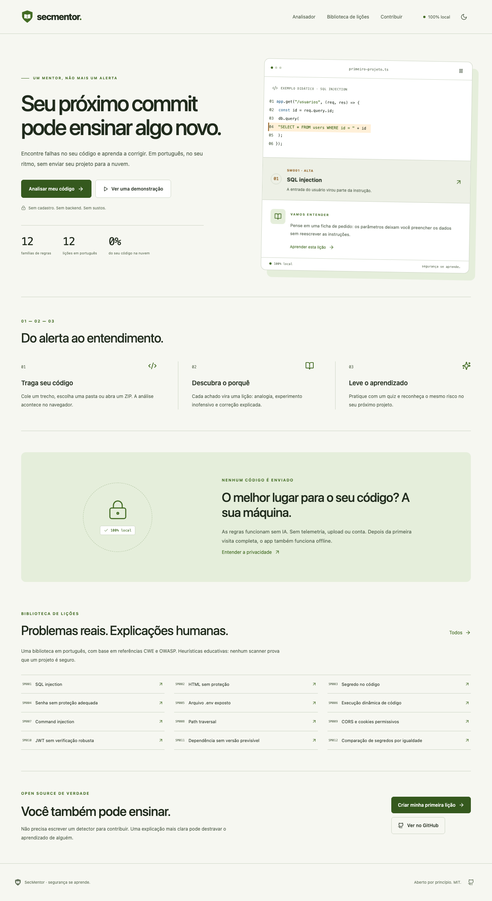
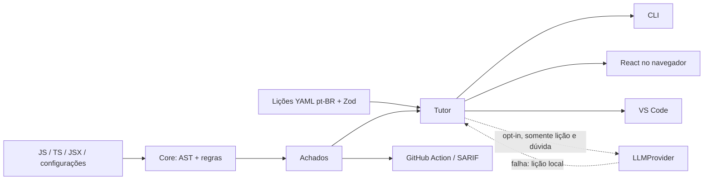

# SecMentor

**Segurança de código que ensina. Em português. Na sua máquina.**

   

Quase todo material de segurança de código está em inglês e é pensado para profissionais. O SecMentor nasce para reduzir essa barreira: detecta falhas comuns no código do aluno e explica, em português e passo a passo, o que é, por que é perigoso, como demonstrar o risco de forma inofensiva e como corrigir. Essa é nossa motivação, não uma estatística de mercado medida.

**O objetivo é o próximo commit do aluno ser melhor — e ele entender por quê.**



## Instalar e rodar

Requisitos: Node 20+ (validado com 20.20.2), Git e Corepack. Clone e entre no projeto:

```sh
git clone https://github.com/pedroprdgs/SecMentor.git
cd SecMentor
```

Habilite pnpm na sua conta, sem sudo, e instale:

```sh
mkdir -p "$HOME/.local/bin"
corepack enable --install-directory "$HOME/.local/bin"
export PATH="$HOME/.local/bin:$PATH"
pnpm install --frozen-lockfile
pnpm build
pnpm secmentor scan examples/
```

O último comando termina com **código 1**, pois os exemplos são vulneráveis de propósito. Não os publique.
A configuração do PATH vale para este Terminal; adicione-a ao seu perfil para persistir. O diretório local evita o erro EACCES em `/usr/local/bin`.

Abra o front end com `pnpm dev`, normalmente em **http://127.0.0.1:5173**. Para apresentar, use **http://127.0.0.1:5173/demo**. A CLI compilada também funciona com `node packages/cli/dist/index.js`.

## Um achado vira uma lição

```text
ALTA SM001 · SQL injection
  express/app.js:14:3
  A consulta mistura SQL e valores variáveis. Use parâmetros.
  Lição: secmentor explain SM001
```

```sh
pnpm secmentor explain SM001
pnpm secmentor quiz SM001
pnpm secmentor scan examples/ --json
pnpm secmentor scan examples/ --sarif > resultado.sarif
pnpm secmentor scan examples/ --severidade-minima alta --ignorar 'SM003,**/fixtures/**'
pnpm secmentor fix caminho/arquivo.js
pnpm secmentor --lessons ./minhas-licoes explain SM001
```

`fix` mostra o diff e exige **sim** antes de escrever. Nesta versão, só ativa `httpOnly: false` em chamadas de cookie reconhecidas. SQL, JWT e segredos exigem mudanças com contexto; suas correções são ensinadas nas lições.

## O que já existe

| Superfície  | Comportamento                                                                                                      |
| ----------- | ------------------------------------------------------------------------------------------------------------------ |
| Core        | 12 regras, AST Babel para JS/TS/JSX, configuração por regex, posições, filtros, avisos e 12 lições Zod             |
| CLI         | Scan, explain, quiz, fix, rules, lint-lessons e init; terminal, JSON e SARIF 2.1.0                                 |
| Front end   | React 18, rotas, CodeMirror 6, Web Worker, arquivos/pastas/ZIP, lições, diff, quiz, criador YAML, relatórios e PWA |
| VS Code     | Diagnósticos, painel lateral, ações rápidas e contagem na barra de status                                          |
| GitHub      | Action composta, resumo didático, comentário de PR elegível, upload SARIF e workflow Pages                         |
| IA opcional | Aprofunda lições, responde dúvidas e gera quiz. Desligada por padrão, com fallback local                           |

As 12 regras cobrem SQL injection, XSS, segredos, senhas fracas, exposição de `.env`, execução dinâmica, command injection, path traversal, CORS/cookies, JWT, dependências imprevisíveis e comparação de segredos.

**Heurísticas educativas, não uma auditoria completa.** Há falsos positivos e falsos negativos. Não há análise de fluxo entre arquivos, resolução completa de escopo ou consulta a bancos de vulnerabilidades de dependências. Confira os [limites por regra](docs/regras.md).

## Privacidade é o padrão

O núcleo não tem cliente HTTP, telemetria ou backend. Scanner e extensão **não executam o código analisado**. O playground usa o mesmo core no navegador, com assets locais e sem fontes/CDNs externas. Depois de instalar e compilar, análise e lições não precisam de internet. O build de produção tem manifest e service worker: após aparecer “Aplicativo pronto para uso offline”, as rotas e o Worker ficam disponíveis sem rede. No modo de desenvolvimento, o service worker não é registrado.

Na CLI, apenas `--ia` habilita acesso ao endpoint explicitamente configurado. No front end, o recurso é habilitado em Configurações e cada envio pede confirmação. O adaptador recebe a lição e, se informada, a dúvida do aluno: **não recebe o arquivo, o caminho nem o trecho detectado**. Não inclua segredos ou código privado em perguntas. Um endpoint remoto recebe esse conteúdo; use um endpoint local se quiser manter tudo na máquina.

```sh
export SECMENTOR_LLM_BASE_URL=http://127.0.0.1:1234/v1
export SECMENTOR_LLM_MODEL=identificador-do-modelo-local
# SECMENTOR_LLM_API_KEY é opcional para endpoints locais.
pnpm secmentor explain SM001 --ia --pergunta 'Por que parâmetros ajudam?'
```

O contrato usa [`POST /chat/completions`](https://developers.openai.com/api/reference/resources/chat), por compatibilidade com endpoints existentes. O projeto não escolhe nem baixa modelos. Falha de rede, resposta inválida ou ausência de configuração retorna conteúdo das lições. A IA **nunca detecta falhas** e suas respostas devem ser revisadas.

Progresso da CLI: `~/.secmentor/progresso.json`; do navegador: `localStorage`, sem sincronização. `SECMENTOR_HOME` permite uma pasta alternativa. Relatórios JSON/terminal ocultam trechos de SM003; outros trechos podem conter dados privados. SARIF não contém código, mas inclui caminhos e mensagens. Publicar relatórios continua sendo uma decisão do usuário. A Action envia o SARIF ao GitHub quando configurada.

## Front end para a apresentação

O pacote existente `packages/playground` foi evoluído, preservando a CLI e os detectores. A entrada leve `@secmentor/core/content` fornece lições e schema; o scanner roda em um **Web Worker**. Não há backend.

- **/**: landing, mini demo pausável e contadores reais do core.
- **/analisar**: CodeMirror 6, arquivos, pastas, ZIP, árvore, progresso, filtros e achados por arquivo.
- **/licoes** e **/licoes/SM001**: biblioteca com busca, tema e severidade; lições com URL própria.
- **/quiz**: cinco perguntas, por lição ou revisão de erros, alternativas embaralhadas e feedback imediato.
- **/progresso**: pontos, níveis, conquistas, sequência de dias e histórico sem código. Exclusão dos dados com confirmação.
- **/contribuir**: criador com validação pelo Zod do core, preview YAML, download e proposta pré-preenchida no GitHub.
- **/configuracoes**: tema do sistema/claro/escuro, fonte do editor e tutor opcional. Credenciais ficam apenas no localStorage, sem criptografia.
- **/demo**: percorre automaticamente analisar → entender → antes/depois → quiz, com pausa e controles manuais.

O painel oferece conteúdo completo, diff sob demanda e correção segura de httpOnly com desfazer. A IA pede confirmação por envio, recebe somente a lição e a pergunta e nunca recebe automaticamente o editor. Explicações/quiz locais permanecem disponíveis se o endpoint falhar ou CORS impedir a chamada.

Importação: até **1.500 entradas**, **1 MiB por arquivo**, **20 MiB de texto por projeto** e **10 MiB por ZIP comprimido**. ZIP64 e arquivos criptografados não são aceitos. Expansão é conferida pelo diretório central e por leitura limitada em blocos. Pastas ignoram node_modules, .git, dist e coverage. Sem metadados Git no navegador, `.env` importado gera alerta de revisão; use a CLI para confirmar rastreamento e ignore.

JSON, SARIF e impressão com explicações ficam no fim da análise. “Criar link do trecho” comprime um arquivo pequeno no fragmento da URL, após aviso: qualquer pessoa com o link poderá ler o código. O código não é salvo no histórico nem enviado a um serviço para criar o link.

```sh
pnpm dev                         # Desenvolvimento
pnpm build                       # Build de todo o monorepo
pnpm preview                     # Servir produção, normalmente porta 4173
pnpm test                        # Core, CLI, stores, utilitários e componentes
pnpm --filter @secmentor/playground exec playwright install chromium
pnpm test:e2e                    # Fluxos reais no build de produção
```

Sem pnpm global, a demo já instalada também inicia com:

```sh
node packages/playground/node_modules/vite/bin/vite.js packages/playground --host 127.0.0.1
```

[Capturas reais Playwright](docs/screenshots/README.md) · [Métricas e Lighthouse](docs/hackathon/METRICAS.md). Para Pages, o workflow usa `VITE_BASE_PATH=/<nome-do-repositorio>/`, manifest com escopo correspondente entradas HTML para cada rota conhecida e `404.html` para recuperar caminhos desconhecidos. Metadados por rota são atualizados no navegador; crawlers que não executam JavaScript recebem os metadados gerais da landing.

## Arquitetura



```text
packages/core         scanner, schema, lições compiladas, relatórios e LLMProvider
packages/cli          comandos e progresso local
packages/playground   Vite + React + Tailwind
packages/vscode       extensão empacotada com esbuild
lessons/pt-BR          fonte das lições
lessons/en            esqueleto de tradução
examples              apps vulneráveis para inspeção local
docs/hackathon        pitch, roteiro, demo, arquitetura e métricas
```

## Desenvolvimento e qualidade

```sh
pnpm build
pnpm lint
pnpm typecheck
pnpm test:coverage
pnpm lint-lessons
pnpm benchmark
```

O build compila as lições antes dos pacotes. Os testes da CLI usam o build: execute `pnpm build` primeiro. A CI usa Node 20 e executa todos esses gates, exceto o benchmark. As métricas executadas e os limites da validação estão em [METRICAS.md](docs/hackathon/METRICAS.md).

Para testar a extensão: abra a raiz no VS Code e pressione F5 com a configuração **SecMentor: testar extensão**. Para gerar VSIX, veja [o guia](packages/vscode/README.md).

## GitHub Action e Pages

`action.yml` pode ser usada como Action local depois de checkout (`uses: ./`) ou via referência deste repositório após publicação. Copie o exemplo em [docs/github-action.md](docs/github-action.md), usando a referência real e, preferencialmente, um SHA revisado. Achados não bloqueiam o job por padrão; análise incompleta bloqueia. O output `exit-code` permite definir a política do repositório.

O workflow [Pages](.github/workflows/pages.yml) publica `packages/playground/dist` após habilitar **Settings → Pages → GitHub Actions** no GitHub. O [site público](https://pedroprdgs.github.io/SecMentor/) está disponível; a [demo](https://pedroprdgs.github.io/SecMentor/demo) também funciona com cache PWA concluído. A publicação pública pode estar atrás dos commits locais da revisão; confira o SHA no GitHub Actions.

## Comunidade e próximos passos

[Contribuir em dez minutos](CONTRIBUTING.md) · [Guia do usuário](docs/guia-do-usuario.md) · [Arquitetura](docs/arquitetura.md) · [Roadmap](docs/roadmap.md) · [Código de conduta](CODE_OF_CONDUCT.md) · [Segurança](SECURITY.md)

Comece por uma das [oito tarefas para iniciantes](docs/good-first-issues.md). Também aceitamos contribuições só nas lições: explicar bem é parte do produto.

Próximos passos: rastreamento de entrada com escopos, validação em outros navegadores, teste automatizado no Extension Host, tradução en completa e estudo com alunos. Não afirmamos impacto educacional medido antes desse estudo.

Licença [MIT](LICENSE). Material do hackathon: [comece aqui](docs/hackathon/README.md).
