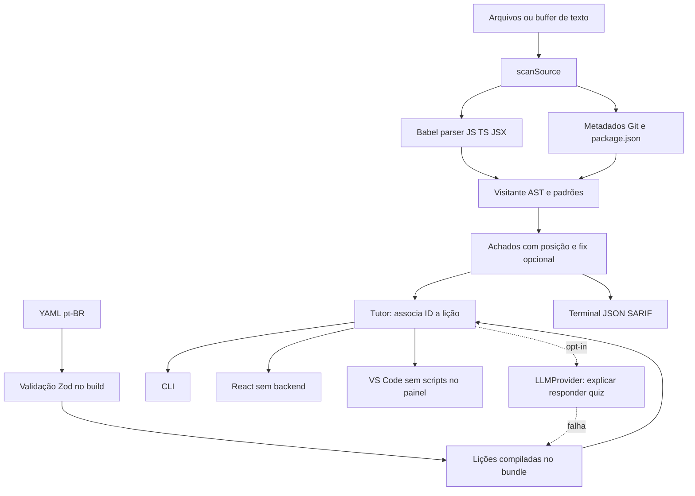

# Arquitetura

## Separação de capacidades

O entrypoint `@secmentor/core` contém scanner, schema Zod, lições compiladas e reporters. Não importa `node:fs` nem o adaptador HTTP. A CLI importa `/node` para a caminhada de arquivos e `/llm` somente para o tutor opcional. O navegador usa `/content` para schema e lições sem carregar Babel. O Web Worker importa o scanner pelo entrypoint principal; reporters e `/llm` são carregados sob demanda.

## Scanner

`scanSource` é síncrono e determinístico, exceto medição de duração. Usa Babel com TypeScript e JSX, visita nós pelas `VISITOR_KEYS` e registra linhas/colunas começando em 1, além de offsets para o fix. Strings e comentários não são tratados como código. Em erro de parse, retorna aviso sem inventar uma análise parcial.

O mapa de aliases é local ao arquivo e não respeita escopos completos; os limites estão em `docs/regras.md`. Não há grafo de chamadas nem execução. Regras de configuração usam nome do arquivo, JSON e informações de Git. As 12 famílias podem emitir mais de um achado por arquivo.

`scanPath` percorre pastas sem seguir links encontrados, pula diretórios de build, aplica globs e consulta o Git em lote. Lê até 24 arquivos por grupo e limita cada um a 1 MiB. Ordena o resultado por arquivo/posição. Caminhos reais normalizados evitam divergências entre `/var` e `/private/var` no macOS.

## Lições e idiomas

YAML é a fonte de verdade. `scripts/compile-lessons.ts` valida arquivos e gera TypeScript versionado. O conteúdo entra no bundle para funcionar sem disco no navegador e no webview. `lint-lessons` confere schema e sincronização com o compilado. Pacotes externos são dados, sem execução; substituem por ID e preservam os demais.

`pt-BR` é completo. `en` contém apenas orientações de tradução, sem fallback silencioso que finja conteúdo traduzido. Um idioma novo pode ser entregue como pacote externo antes de entrar no bundle principal.

## IA e privacidade

O adaptador implementa `LLMProvider`: `explain`, `answer` e `generateQuiz`. Não recebe fonte do arquivo nem controla o scanner. Usa Chat Completions por compatibilidade, não SDK específico, com fetch nativo do Node 20, timeout de oito segundos, redirects recusados e schema de resposta. Só inicializa pelo opt-in.

Respostas de quiz são validadas. Explicações são texto sem execução. A qualidade pedagógica e factual de IA não é garantida; o aluno deve revisar. O fallback local não depende do endpoint. A pergunta digitada pode sair da máquina quando IA é habilitada, então não deve incluir material privado.

## Entregas e fronteiras

VS Code agrupa o core em CommonJS com esbuild. Atualizações de buffer têm debounce de 300 ms e cache por versão. O painel desabilita scripts e usa CSP/escape de HTML. O playground usa Vite, React e Tailwind, com CSS sem fontes remotas. O mesmo scanner é usado nas superfícies.

A Action instala as dependências do scanner com lockfile congelado e scripts de instalação desabilitados; não instala dependências do projeto analisado. Envia SARIF sem snippets e pode comentar somente PRs do mesmo repositório. Forks recebem resumo do job; configurações de permissões dependem do GitHub.

## Front end e armazenamento

`packages/playground/src/app` define shell, tema do sistema, rotas lazy, PWA e dicionário centralizado. `features` separa análise, lições, quiz, progresso, contribuição e preferências. CodeMirror e diff são carregados sob demanda. O Worker troca mensagens tipadas de progresso/resultado e é encerrado ao concluir, cancelar ou exceder trinta segundos.

Código fica no store de memória; não é persistido no histórico. Zustand persiste apenas preferências, credenciais opt-in, resultados de quiz e contagens/nomes recentes. Dados restaurados passam por Zod; armazenamento indisponível mantém a sessão em memória. A exclusão remove apenas chaves do SecMentor.

ZIP usa JSZip com validação do diretório central e leitura em blocos limitada por arquivo. Pastas e arquivos são virtuais: não há escrita no filesystem nem execução de módulos. Compartilhamento usa CompressionStream e fragmento de URL, com confirmação e limite de tamanho também na descompressão.

O service worker guarda assets do app, incluindo rotas lazy e Worker, não respostas de IA ou código do editor. Novas versões pedem consentimento antes de recarregar e descartar código em memória. O fallback 404 preserva caminho/query/hash para o GitHub Pages; VITE_BASE_PATH define o escopo do repositório.
