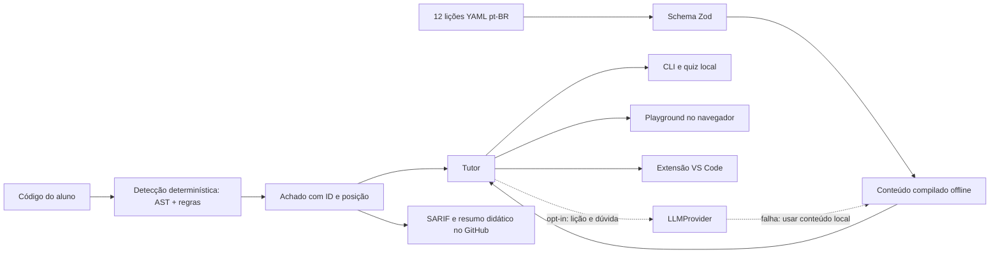

# Arquitetura para a apresentação

**Fronteira essencial:** o adaptador de IA não recebe arquivo nem snippet. A detecção não depende do modelo. O core do navegador não importa módulos de filesystem nem cliente HTTP do tutor.

A extensão usa painel sem scripts e conteúdo escapado. O scanner não executa projetos. A CLI grava progresso local e só aplica um diff após confirmação. SARIF e comentários são transmissões ao GitHub quando a Action é usada; não confundimos integração de CI com uma operação inteiramente offline.

Veja [arquitetura técnica](../arquitetura.md) para fluxo de arquivos, limitações de aliases, configuração e pacotes de idioma.

A revisão de QA conferiu cinco demos sem tráfego externo, timeout do tutor em 8 s e processamento de 1.000 arquivos no Worker com a UI ativa. O build gera um HTML por rota conhecida para servir F5 no Pages com HTTP 200; `404.html` permanece como fallback para caminhos desconhecidos. Consulte [METRICAS.md](METRICAS.md) para medições e limites.
